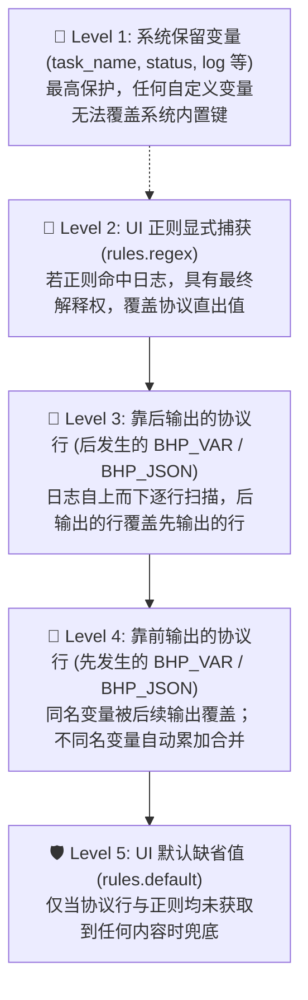

# 消息中心

消息中心集成了一整套灵活且现代的消息分发引擎，支持多场景自动推送到外部 IM 工具。

## 消息通道

- **企业 IM**：支持集成 **企业微信** (WeCom)、**钉钉** (DingTalk)、**飞书** (Lark)。
- **个人推送到位**：支持 **Telegram** Bot、**Bark** (支持自建)、**Server酱** (ServerChan Turbo/SCKEY)、**VoceChat** (支持自建) 以及基于 **WxPusher** / **PushPlus** / **PushMe** 等服务。
- **公共渠道**：标准的 **SMTP 邮件** 及 **Webhook** 回调。

## 事件通知规则

- **多事件配置**：您可以灵活定义在哪些场景下触发通知，包括但不限于：
    - **任务失败**：定时任务在 Cron 触发后运行报错。
    - **任务超时**：任务由于运行过长被系统中止。
    - **登录安全**：检测到异地登录或多次密码错误。
    - **服务下线**：Agent 节点掉线提醒。

## 推送使用路径

baihu-panel提供了两种不同层面的通知推送方式，满足从“自动报警”到“程序内自定义推送”的全场景需求。

---

### 路径一：任务绑定通知（零代码自动化）

这是最常用的方式，用于在定时任务执行完成后，根据结果自动发送通知。

1. **入口**：在 **「定时任务」** 页面，点击任务右侧的 **「编辑」**。
2. **配置**：在弹窗底部的 **「通知配置」** 栏目中：
    - **选择渠道**：指定发送消息的 IM 渠道。
    - **触发时机**：勾选 `成功时`、`失败时` 或 `超时时`（建议至少勾选失败和超时）。
    - **附带日志**：开启后可在消息中直接预览报错日志，支持设置截取长度。
3. **生效**：保存后，该任务每次运行结束都会按设定的逻辑自动推信。

---

### 进阶：自定义变量提取与模板注入 (Issue #196)

在很多自动化任务（如每日签到、积分打卡、资产监控等）中，我们不仅希望知道任务“成功或失败”，还希望在通知消息里直接看到关键业务指标（例如：**获取的硬币数量**、**当前经验等级**、**执行汇总摘要**）。

白虎面板提供了**双轨变量提取机制**，支持自动将脚本输出中的数据提炼为模板变量（如 `{{coins}}`、`{{exp}}`、`{{summary}}`），并在所有通知渠道中自由组合引用。

#### 1. 双轨提取方式对比

| 提取机制 | 适用场景 | 侵入性 | 使用方式 |
| :--- | :--- | :--- | :--- |
| **方式 A：标准协议直出** | 自研脚本、可修改源码的任务 | **代码级 (免配置)** | 脚本在 stdout 输出指定格式单行，系统自动无感提取 |
| **方式 B：日志正则提取** | 第三方开源脚本、Docker 镜像、外部依赖 | **零侵入 (UI 配置)** | 在任务「通知配置」中配置正则表达式，自动从控制台日志捕获 |

---

#### 2. 方式 A：标准协议直出（免配置）

如果任务脚本是您自己编写或维护的，推荐直接在控制台输出标准协议格式。白虎面板在收集日志时会自动扫描并解构提取，**无需在面板 UI 中配置任何正则规则**：

##### 语法 1：标准前缀键值对 (支持 `[BHP_VAR]`, `[NOTIFY_VAR]`, `[OUTPUT]`)
```bash
# Python 示例
print("[BHP_VAR] coins=50")
print("[BHP_VAR] exp=100")
print("[NOTIFY_VAR] summary=所有任务已成功执行")

# Shell 示例
echo "[BHP_VAR] coins=50"

# Node.js 示例
console.log("[BHP_VAR] coins=50");
```

##### 语法 2：GitHub Actions 风格 `set-output`
与 GitHub CI/CD 生态高度兼容，现有基于 Actions 的脚本可直接无缝迁移：
```bash
echo "::set-output name=coins::50"
echo "::set-output name=exp::100"
```

##### 语法 3：JSON 结构体解构 `[BHP_JSON]`
当需要一次性输出多个结构化指标时，可使用 JSON 单行格式：
```bash
# Python 示例
import json
data = {"coins": 50, "exp": 100, "level": 6, "summary": "全部签到完成"}
print(f"[BHP_JSON] {json.dumps(data)}")
```

---

#### 3. 方式 B：日志正则捕获（零侵入）

针对第三方开源脚本（无法或不便直接修改脚本源码输出），可在任务的 **「编辑」** -> **「通知配置」** -> **「日志变量正则提取」** 中添加规则：

- **变量名称 (Key)**：定义变量名（字母、数字、下划线），例如 `coins`。在模板中即可通过 `{{coins}}` 引用。
- **捕获正则 (Regex)**：正则表达式。**优先取第 1 捕获组 `(\d+)`** 作为提取结果；若无捕获组则取整段匹配内容。
- **默认值 (Default)**：当日志中未匹配到该内容时的备选回退值（如 `0` 或 `无`）。

##### 常用场景正则示例表：

| 变量名 | 日志原始内容示例 | 正则表达式 (Regex) | 提取结果 |
| :--- | :--- | :--- | :--- |
| `coins` | `[INFO] 今日获得硬币: 50 枚` | `获得硬币[：:]\s*(\d+)` | `50` |
| `exp` | `每日经验奖励 +15 点` | `经验奖励\s*\+(\d+)` | `15` |
| `balance` | `当前账户可用余额: 199.50元` | `可用余额[：:]\s*([\d\.]+)` | `199.50` |
| `summary` | `【执行结论】打卡成功，用时 3 秒` | `【执行结论】([^\n\r]+)` | `打卡成功，用时 3 秒` |

---

#### 4. 在通知模板中使用完整实例

提取出的自定义变量与面板原生内置变量（`{{task_name}}`、`{{status}}`、`{{duration}}`、`{{log}}` 等）完全互通，可在「通知配置」或「通知渠道模板」中自由引用。

##### 示例：企业微信 / 钉钉 / 飞书 Markdown 模板
```markdown
### 📢 任务运行完成: {{task_name}}
- **运行结果**: {{status}}
- **执行耗时**: {{duration}}
- **获得硬币**: {{coins}} 枚
- **增加经验**: {{exp}} 点
- **当前等级**: Lv{{level}}
- **执行摘要**: {{summary}}

> 详细日志可在白虎面板后台查看。
```

##### 示例：Bark / 个人推送标题与内容
- **标题**：`{{task_name}} 执行{{status}} (奖励: +{{coins}}硬币)`
- **正文**：`今日共获得 {{coins}} 硬币与 {{exp}} 经验，状态：{{summary}}`

---

#### 5. 变量叠加与覆盖规则（优先级矩阵）

当同一变量名出现在脚本多次输出、不同协议、UI 正则或与系统内置变量重名时，系统遵循以下确定性的**五层优先级与覆盖次序**：



##### 核心覆盖场景释义：
1. **多次输出同名变量（时间先后顺序覆盖）**：
   - 若任务循环执行多次（如重试打卡或多账号循环），脚本中先后打印了 `[BHP_VAR] coins=10` 和 `[BHP_VAR] coins=50`。
   - **行为**：系统自上而下按行序扫描日志，**靠后输出的值会覆盖靠前的值**，最终提取到最终完成状态（`coins=50`）。
2. **多指标 JSON 累加合并**：
   - 若脚本先后输出 `[BHP_JSON] {"coins": 10, "exp": 20}` 与 `[BHP_JSON] {"coins": 50, "summary": "完成"}`。
   - **行为**：不同名的 Key（`exp`、`summary`）自动**累加保留**，同名 Key（`coins`）后输出的 `50` **覆盖**前面的 `10`。
3. **协议直出 与 UI 正则规则的优先级**：
   - 若第三方开源脚本自身已经打印了 `[BHP_VAR] coins=10`，但在面板 UI 配置了正则 `获得硬币[：:]\s*(\d+)` 匹配出了 `50`。
   - **行为**：**UI 正则捕获值优先生效**（覆盖协议值）。但若正则**未匹配到任何内容**，系统将安全保留协议直出值 `10`，绝不盲目回退到默认值。
4. **系统内置保留键绝对防篡改**：
   - 脚本中若恶意或意外输出 `[BHP_VAR] status=成功` 或 `[BHP_VAR] task_name=伪造名称`。
   - **行为**：系统在合并变量时检测到该 Key 为系统内置原生变量，**自动拒绝覆盖**，确保系统运行状态、错误信息与日志的真实准确。

---

### 路径二：脚本手动调用 (内置助手库 - 推荐)

baihu-panel提供了一套**零配置**的内建助手库（Built-in SDK），支持 Python 和 Node.js。除了支持极简的消息通知投递外，它还支持管理面板的**环境变量**与**定时任务控制**。

#### 1. 如何获取配置 Key？
在使用助手库前，请确保您已经在任务设置的“环境变量”或“机密”中配置了以下对应 Key：
- **消息推送相关**：
  - `BHPKG_NOTIFY_TOKEN`：进入「消息推送」->「脚本调用说明」标签，可以直接复制此处的 Token。
  - `BHPKG_NOTIFY_CHANNEL`：进入「消息推送」->「渠道列表」标签，可以查看每个渠道对应的 **ID**。
  - `BHPKG_NOTIFY_URL` (可选)：内置通知 API 的地址。默认为 `http://localhost:8052/api/v1/notify/send`。
- **环境与任务管理相关**：
  - `BHPKG_OPENAPI_TOKEN` (或 `OPENAPI_TOKEN`)：OpenAPI 鉴权 Token，在「系统设置」->「OpenAPI」中生成。
  - `BHPKG_OPENAPI_URL` (可选)：默认为本地面板 API 地址。

#### 2. 环境初始化
在开始编写脚本前，您需要在终端执行以下命令，为面板管理的所有语言环境安装 `baihu` 包：

```bash
baihu builtininstall
```
*该操作会将助手库安装到 mise 管理的所有版本中，确保 import 成功。*

#### 3. 代码示例

##### Python (同步调用)
```python
import baihu

# 基本消息通知
baihu.notify("任务标题", "通知正文内容")

# 指定内容格式（text/markdown/html）
baihu.notify("任务标题", "**加粗内容**", format='markdown')

# 指定渠道
baihu.notify("任务标题", "正文", channel_id='ch-xxx')

# 推荐写法：通过 options 字典下发控制格式与 Bark 等渠道的个性化参数 (如 group, icon, sound, url 等)
baihu.notify("打卡完成", "今日 B站任务已全量完成！", 
    channel_id='ch-bark-01',
    options={
        'format': 'markdown',
        'group': 'B站自动化',                    # Bark 消息分组
        'icon': 'https://example.com/logo.png', # Bark 自定义图标
        'sound': 'glass',                      # Bark 提示音
        'url': 'https://bilibili.com'           # Bark 点击跳转链接
    }
)

# 环境变量与任务管理（详细用法见内置库示例）
envs = baihu.get_envs()
tasks = baihu.get_tasks()
```

##### Node.js (异步调用)
```javascript
const baihu = require('baihu');

// 基本消息通知 (可直接调用，也支持 await 获取执行回执)
baihu.notify("任务标题", "通知正文内容");

// 推荐写法：通过 await 获取发送回执
(async () => {
    const res = await baihu.notify("任务标题", "**加粗内容**", { format: "markdown" });
    if (!res.success) {
        console.error("发送失败:", res.error);
    }
})();

// 指定渠道
baihu.notify("任务标题", "正文", { channel_id: "ch-xxx" });

// 推荐写法：通过 options 对象统一传递控制格式与 Bark 等渠道个性化参数
baihu.notify("打卡完成", "今日 B站任务已全量完成！", {
    channel_id: "ch-bark-01",
    options: {
        format: "markdown",
        group: "B站自动化",                     // Bark 消息分组
        icon: "https://example.com/logo.png",  // Bark 自定义图标
        sound: "glass",                        // Bark 提示音
        url: "https://bilibili.com"            // Bark 点击跳转链接
    }
});

// 环境变量与任务管理（详细用法见内置库示例）
(async () => {
    const envs = await baihu.getEnvs();
    const tasks = await baihu.getTasks();
})();
```

> [!TIP]
> 关于环境变量增删改查以及任务触发控制的完整 API 列表与更详尽的代码，请参考 [内置库示例](./examples/builtin.md)。


---

### 路径三：其他语言/高级调用 (原始 API)
> [!IMPORTANT]
> 以下示例中的端口均默认为 `8052`。如果您更改了容器内部的服务端口（通过 `BH_SERVER_PORT` 环境配置），请务必在调用时将 `8052` 替换为您的实际端口。

如果您使用 Shell 或其他尚未提供助手库的语言，可以通过标准 HTTP POST 请求调用。

#### 1. 快速获取代码
进入 **「消息推送」** -> **「脚本调用说明」** 标签，页面会根据您的配置自动生成包含 **通知 Token** 和 **默认渠道 ID** 的完整代码。

#### 2. 代码参考示例

##### Shell (Curl)
> **注意**：如果更改了容器内部的服务端口，请将 `8052` 替换为实际端口，或直接使用环境变量 `BHPKG_NOTIFY_URL`。

```bash
curl -X POST "http://localhost:8052/api/v1/notify/send" \
  -H "notify-token: 您的_NOTIFY_TOKEN" \
  -d '{"channel_id":"渠道ID", "title":"标题", "content":"内容", "format":"markdown"}'
```

##### 基础 Python (requests)
```python
import requests

def send_notify(title, content, format="text"):
    url = "http://localhost:8052/api/v1/notify/send"
    headers = { "notify-token": "您的_NOTIFY_TOKEN" }
    data = {"channel_id": "您的_渠道_ID", "title": title, "content": content, "format": format}
    requests.post(url, headers=headers, json=data)
```

---

## 消息中心管理

除了配置发送路径，您还可以在消息中心进行以下操作：

- **发送记录 (审计)**：实时记录每一条通过baihu-panel发送至外部的消息，方便追溯。
- **回执查询**：在 **「消息日志」** 页面查看到每条推送的详细状态，如果发送失败，会提供原始的错误响应代码以供排查。
