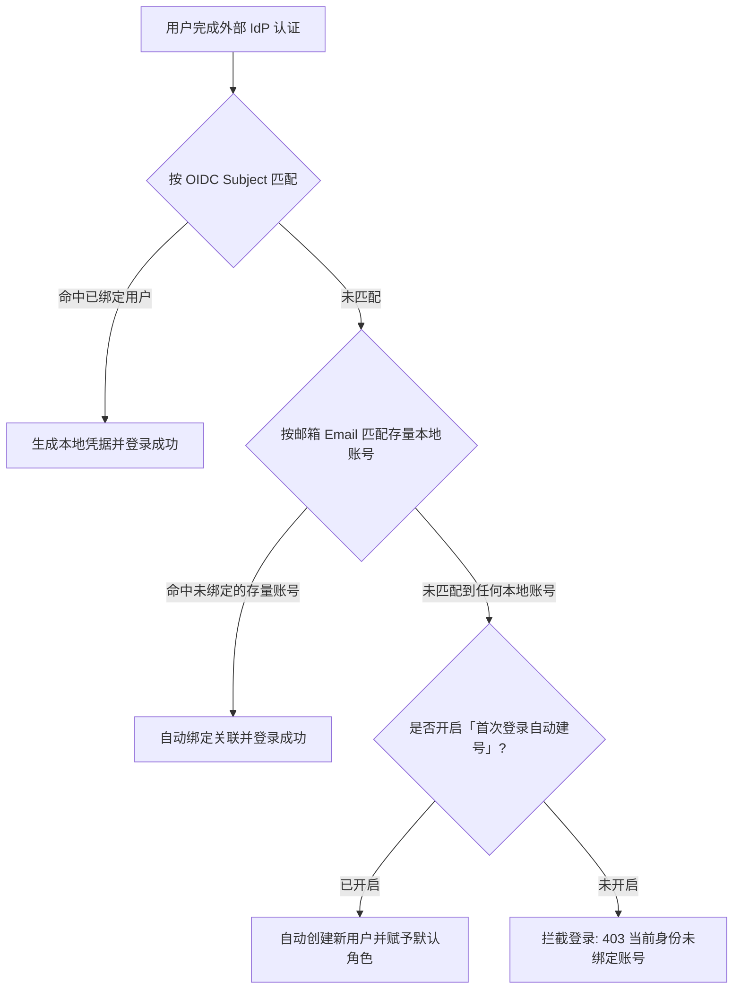

# 安全与登录认证

白虎面板 (baihu-panel) 提供了一套现代、严密且灵活的多层账户安全防御体系。除传统的用户名与高强度哈希密码外，系统内置了基于时间戳的 **两步验证 (2FA / OTP)** 以及标准 **单点登录 (SSO / OIDC)** 两大核心安全功能块，既能满足个人极客对防御凭据撞库的苛刻要求，也能无缝融入企业与私有内网的统一身份管理体系。

---

## 一、 功能块 1：两步验证 (2FA / OTP)

两步验证（Two-Factor Authentication，简称 2FA）通过结合**“你知道的凭据（密码）”**与**“你拥有的设备（手机验证器）”**，为面板管理权限提供双重加锁。即便登录密码不幸泄露，攻击者在没有物理设备动态口令的情况下依然无法进入系统。

### 1.1 核心机制与优势

- **通用 TOTP 动态口令算法**：严格遵循 **RFC 6238** 标准，由移动端离线每 30 秒独立计算刷新一次 6 位纯数字验证码，完全不依赖短信通道、第三方网络或公网服务，断网环境下依然稳定可用。
- **全生态客户端兼容**：原生兼容市面上所有主流身份认证器应用，包括但不限于：
  - **Google Authenticator**（谷歌身份验证器）
  - **Microsoft Authenticator**（微软验证器）
  - **Bitwarden** / **1Password** / **KeePass** 等密码管理器内置的 TOTP 生成器
- **安全防解绑与防爆破拦截**：关闭两步验证时，必须再次输入当前设备生成的 6 位动态验证码进行二次校验，防止会话被窃取后的恶意降级操作；同时内置登录错误频控防爆破拦截。
- **备份容灾一致性**：面板备份与恢复引擎原生支持安全序列化 `OtpSecret` 与 `TokenVersion`，系统数据迁移或重装还原后，已绑定的 2FA 依然保持生效，无需重新扫码。

### 1.2 配置与激活向导

以管理员身份登录面板，进入 **「系统设置」 > 「安全设置」 > 「两步验证 (2FA) 安全盾」**：

1. **发起配置**：点击 **「立即配置两步验证」** 按钮，系统将在服务端生成唯一的高熵 Base32 密钥与标准的 `otpauth://` 扫码协议链接。
2. **扫码绑定**：
   - 打开手机上的身份验证器 App；
   - 扫描向导弹出的高清二维码；
   - *（备用途径）*：若手机摄像头损坏或在另一台设备上操作，可手动复制页面上显示的明文 Base32 密钥录入到验证器中。
3. **双向校验与激活**：在向导第 3 步输入验证器当前实时显示的 6 位动态验证码，点击 **「校验并完成绑定」**。服务端验证通过后即刻全面生效。

### 1.3 登录流程与体验

- 开启两步验证后，用户在登录界面输入正确的账号与密码提交；
- 系统校验账密无误后，会自动无缝切换至 **「两步验证安全口令」** 输入卡片；
- 输入手机验证器 App 上的当前 6 位验证码，回车即可完成登录并换发正式会话凭证。

### 1.4 关闭与解绑

若您计划更换手机设备或重置验证器，可在「两步验证」卡片点击 **「关闭两步验证」**：
- 系统将弹出二次验证抽屉；
- 输入当前验证器显示的 6 位动态码确认，即可安全解绑。

---

## 二、 功能块 2：单点登录 (SSO / OIDC)

单点登录功能允许白虎面板直接作为标准客户端（Relying Party），无缝对接企业与私有内网的统一身份提供商（IdP），如 **Pocket ID**、**Keycloak**、**Authentik**、**Authelia** 等，实现免密登录、集中账号授权与合规审计。

### 2.1 核心机制与安全设计

- **标准授权码流程 + 强制 PKCE**：基于 `coreos/go-oidc/v3` 与 `golang.org/x/oauth2` 构建，强制要求 **PKCE (S256 挑战码)**，防范授权码在网络跳转过程中的中间人拦截与重放劫持。
- **动态 JWKS 验签缓存**：自动请求提供方的 OpenID 发现端点 (`/.well-known/openid-configuration`) 动态拉取与缓存公钥，自动完成数字签名验签，无需手工繁琐维护公钥证书。
- **状态参数 (State) 严密防伪**：授权生命周期使用的 `state` 与 `verifier` 严格存储在 `HttpOnly` Cookie 中（生命周期 10 分钟），校验完毕即刻销毁，伪造或篡改请求直接被 401 拦截。
- **防开放重定向 (Open Redirect)**：回调跳回路径严格限制为站内合法相对路径（以 `/` 开头且非 `//`），杜绝网络钓鱼伪造跳转。
- **客户端密钥 (Client Secret) 密文落库**：前端回显始终采用掩码脱敏 (`********`)；保存时通过环境变量 `BAIHU_SECRET_KEY` 驱动的 **AES-GCM** 算法加密存储入库。

### 2.2 身份流转与建号策略

当外部 IdP 授权成功重定向回白虎面板时，系统按照以下顺序定位并关联本地账号：



1. **按 Subject 唯一定位**：优先根据 IdP 下发的不可变用户唯一标识 (`sub`) 匹配。若已绑定，直接登录。
2. **存量同名邮箱关联**：若为存量系统改造，外部 IdP 邮箱与本地已有尚未绑定的账号一致，系统自动完成关联绑定。
3. **自动建号与权限隔离**：
   - **开启自动建号**：无需管理员预先录入，首次登录根据 IdP 返回的用户名/邮箱自动生成本地账号，并分配指定的默认角色（普通用户 / 管理员）。
   - **关闭自动建号**：陌生外部身份将被直接拒绝登录（提示 `当前 OIDC 身份未绑定任何账号，请联系管理员`），防止未受信任人员进入。

### 2.3 参数配置对照表

在 **「系统设置」 > 「安全设置」 > 「OIDC 单点登录」** 卡片进行配置：

| 配置项 | 参数说明 | 参考范例 |
| :--- | :--- | :--- |
| **启用 OIDC 登录** | 总开关。开启后在登录页显示快捷登录按钮。 | 开关切换 |
| **Issuer (发现文档地址)** | OIDC 身份提供商的完整基础访问 URL。 | `https://id.example.com` |
| **Client ID** | IdP 颁发给白虎面板的客户端标识符。 | `baihu-panel` |
| **Client Secret** | 客户端密钥。前端回显脱敏，留空表示不修改。 | `sec_xxxxxxxxxxxx` |
| **回调地址 (Redirect URI)** | 授权完成后跳回面板的处理端点。需与 IdP 完全一致。 | `https://<面板地址>/api/v1/auth/oidc/callback` |
| **附加 Scope (可选)** | 申请的扩展授权范围（逗号或空格分隔）。默认包含 `openid, profile, email`。 | `groups, roles` |
| **首次登录自动创建账号** | 陌生身份初次登录时是否允许自动注册。 | 开关切换 |
| **自动创建账号的角色** | 自动建号时的初始权限分配。 | `普通用户` / `管理员` |

### 2.4 主流 IdP 接入示例

#### 对接 Pocket ID (推荐)
1. 登录 Pocket ID，在 **Clients** 页面新建客户端，填写应用名称及回调地址：
   ```text
   https://panel.example.com/api/v1/auth/oidc/callback
   ```
2. 复制生成的 **Client ID** 与 **Client Secret**。
3. 在白虎面板填入 Pocket ID 访问根地址作为 **Issuer**，并粘贴 Client ID 和 Secret 保存。

#### 对接 Keycloak
1. 进入 Keycloak 对应 Realm 的 **Clients**，创建 `OpenID Connect` 客户端（Client ID 如 `baihu-panel`）；
2. 开启 **Client authentication**（Confidential 模式），**Valid redirect URIs** 填入白虎面板回调地址；
3. 在 **Credentials** 页面复制 Client Secret；
4. 面板中 **Issuer** 填写 `https://<Keycloak地址>/realms/<Realm名称>` 并保存。

#### 对接 Authentik
1. 在 Authentik 的 **Applications > Providers** 创建 `OAuth2/OpenID Provider`（类型为 Confidential）；
2. 填入白虎面板的回调地址，并将其关联至对应的 Application；
3. 复制生成的 Issuer URL、Client ID 及 Client Secret 填入白虎面板。

---

## 三、 两大功能块的协同防护 (2FA + OIDC)

白虎面板的两大安全功能块并非相互孤立，而是可以叠加构建**纵深防御**：

- **单因子保护**：仅使用用户名与密码；
- **双因子防御 (2FA)**：密码 + 移动端 TOTP 动态口令；
- **企业单点登录 (SSO)**：通过 OIDC 接入公司企业身份库，由企业 IdP 统管账号生命周期与单点登出；
- **最高防御级别 (OIDC + 2FA)**：
  - 用户通过企业 OIDC 单点登录授权成功后，若绑定的本地账号同时开启了 **两步验证 (2FA)**，系统在生成正式会话前依然会提示要求输入移动端动态验证码！
  - 该机制实现了即使外部 IdP 会话处于常驻登录状态，关键运维管理操作仍需二次物理确认的最高防护水准。

---

## 四、 常见问题排查 (FAQ)

### Q1: 输入两步验证动态口令总是提示“验证码错误”？
- **原因**：TOTP 算法依赖严格的时间同步。若服务器系统时钟与手机时钟偏差超过 30 秒，动态验证码将被判定失效。
- **解决**：请检查白虎面板宿主机或容器的时间同步状态（建议配置 NTP 自动校时），并确认手机的“日期与时间”设置为“自动同步网络时间”。

### Q2: 手机意外丢失或误删验证器，无法登录面板怎么办？
- **本地环境/容器控制台重置**：登录部署服务器的终端，使用管理员工具或直接重置账号状态；
- 若配置了备份自动同步，可通过备份恢复至未开启状态。

### Q3: 点击 OIDC 登录提示“无法连接 OIDC 提供方，请检查 Issuer 配置”？
- **原因**：面板后端向 `Issuer` 请求 `/.well-known/openid-configuration` 超时或网络不可达。
- **解决**：检查面板后端容器对 IdP 域名的网络连通性与内网 DNS 解析，确保 Issuer 地址不包含多余的子路径。

### Q4: OIDC 授权后跳转提示“OIDC state 校验失败”？
- **原因**：登录跳转与回调之间的 Cookie 丢失。通常发生在跨协议跳转（例如反代端由 HTTP 强转 HTTPS 导致 Cookie 未能携带）或跨顶级域名配置错误时。
- **解决**：请检查反向代理网关的 `Host` 头传递配置，确保全站使用统一的标准 HTTPS 协议访问。

### Q5: 演示模式 (Demo Mode) 下可以配置这些安全项吗？
- 演示模式下已严格禁用了凭据修改、两步验证操作与 OIDC 参数保存，防止公开测试环境被恶意劫持。
